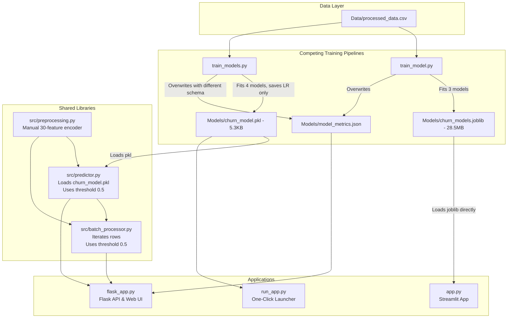

# PHASE 1A: Comprehensive Repository Audit & Architecture Defect Report

**Project:** Telecom Customer Churn Prediction & Risk Analysis  
**Repository:** `Telecom_Churn_ML-main`  
**Audit Date:** October 2026  
**Auditor:** Senior ML, Backend & QA Engineer  
**Status:** Baseline Completed — No destructive code changes made prior to audit  

---

## 1. Executive Summary

An exhaustive engineering audit was performed across all source files, model artifacts, datasets, APIs, web interfaces, and test suites. The repository is functional in parts (18 baseline tests pass), but suffers from critical architectural fragmentation:

1. **Dual Competing ML Pipelines:** `train_model.py` and `train_models.py` train different model sets, use different feature preprocessing strategies, evaluate against different metrics, and output mutually incompatible model artifacts (`churn_models.joblib` vs `churn_model.pkl`).
2. **Disconnected Inference Engines:** Streamlit (`app.py`) loads `churn_models.joblib` (a 28.5 MB dictionary containing 3 models with Random Forest as best), whereas Flask (`flask_app.py`), `run_app.py`, and `src/predictor.py` load `churn_model.pkl` (a 5.3 KB Pipeline containing only Logistic Regression).
3. **Threshold Selection & Evaluation Leakage:** In `train_models.py`, the reported "Optimal Threshold" (0.3585) is calculated directly on the held-out test split (`y_test`), violating fundamental ML validation integrity. Furthermore, this threshold is never saved to the model artifact and is ignored in all inference paths (`predictor.py`, `batch_processor.py`, `flask_app.py`, `app.py`), which all default to a hardcoded 0.5 decision boundary.
4. **Financial Assumptions & Validity:** Customer Lifetime Value (CLV), Revenue at Risk, and Retention Budget formulas rely on undocumented magic numbers, lack input validation against negative or non-finite values, and inappropriately frame risk reduction as guaranteed "revenue saved".
5. **Nested Directory Structure:** The project files are nested within `Telecom_Churn_ML-main/Telecom_Churn_ML-main` rather than the workspace root, breaking standard VS Code, pytest, and CI/CD discovery.

---

## 2. Environment Baseline

- **Operating System:** Windows 10/11 (AMD64)
- **Python Version:** 3.14.6 (CPython)
- **Virtual Environment:** `.venv` (created via `uv venv` using CPython 3.14.6)
- **Installed Key Dependencies:**
  - `streamlit`: 1.66.0
  - `flask`: 3.1.3
  - `flasgger`: 0.9.7.1
  - `scikit-learn`: 1.9.1
  - `xgboost`: 3.4.1
  - `pandas`: 3.0.6
  - `numpy`: 2.5.4
  - `joblib`: 1.6.0
  - `matplotlib`: 3.11.2
  - `seaborn`: 0.13.2
  - `pytest`: 9.1.1

---

## 3. Repository File Tree & Component Inventory

```text
Telecom_Churn_ML-main/
├── .gitignore                          # Basic git ignore rules (lacks IDE & test cache entries)
├── app.py                              # Streamlit dashboard (loads churn_models.joblib)
├── flask_app.py                        # Flask API & Swagger UI (loads churn_model.pkl)
├── README.md                           # Documentation (only references train_model.py & Streamlit)
├── requirements.txt                    # Unpinned / loose dependency specifications
├── run.bat                             # Windows launcher script
├── run_app.py                          # Python launcher (starts Flask & opens browser)
├── train_model.py                      # Training script A -> churn_models.joblib (28.5MB)
├── train_models.py                     # Training script B -> churn_model.pkl (5.3KB)
├── ui-shot.png                         # Screenshot asset
├── Data/
│   └── processed_data.csv              # IBM Telco customer dataset (7,043 rows, 32 cols)
├── Models/
│   ├── backup_original/                # Audit safety backup of original artifacts
│   │   ├── churn_model.pkl
│   │   ├── churn_models.joblib
│   │   └── model_metrics.json
│   ├── churn_model.pkl                 # Pipeline: StandardScaler + LogisticRegression (5.3KB)
│   ├── churn_models.joblib             # Dict of 3 models: LR, DT, RF (28.5MB)
│   └── model_metrics.json              # Overwritten by train_models.py (16.2KB)
├── src/
│   ├── __init__.py
│   ├── batch_processor.py              # CSV batch scoring & financial aggregates
│   ├── predictor.py                    # Inference, risk levels, financial impact, SHAP/log-odds
│   └── preprocessing.py                # 30-feature manual dummy variable encoder
├── static/
│   ├── script.js                       # Frontend JavaScript for Flask UI
│   └── style.css                       # Frontend CSS styling
├── templates/
│   └── index.html                      # Flask HTML template
└── tests/
    ├── __init__.py
    ├── conftest.py                     # Pytest fixtures (client, model, customer payloads)
    ├── test_api.py                     # Flask API integration tests (8 tests)
    ├── test_predictor.py               # Predictor & financial unit tests (5 tests)
    └── test_preprocessing.py           # Preprocessing unit tests (5 tests)
```

---

## 4. Dataset Schema & Data Quality Audit

Inspection of `Data/processed_data.csv`:

- **Row Count:** 7,043 rows
- **Column Count:** 32 columns
- **Missing Values:** 0 across all columns
- **Duplicate Rows:** 22 exact duplicate records detected
- **Target Columns Present in File:**
  - `Churn Value` (int64): `0`: 5,174 (73.46%), `1`: 1,869 (26.54%)
  - `Churn Label_Yes` (bool): `False`: 5,174, `True`: 1,869
- **Feature Set:**
  - 3 numerical features: `Tenure Months` (int64), `Monthly Charges` (float64), `Total Charges` (float64)
  - 27 one-hot encoded categorical features (bool dtypes)
  - 2 target labels (`Churn Value`, `Churn Label_Yes`)
- **Leakage Risk Analysis:**
  - `Churn Label_Yes` is identical to `Churn Value`. If not explicitly dropped, it provides 100% target leakage. Both training scripts drop it, but `processed_data.csv` contains pre-dummified columns which couples the dataset to specific category names.

---

## 5. Model Artifact Audit

| Artifact Name | Size | Serializer | Contents | Consumed By |
|---|---|---|---|---|
| `Models/churn_model.pkl` | 5,361 bytes | `joblib` | `Pipeline(ColumnTransformer, LogisticRegression)` | `flask_app.py`, `src/predictor.py`, `run_app.py`, `tests/conftest.py` |
| `Models/churn_models.joblib` | 28,525,457 bytes | `joblib` | `dict` containing 3 fitted pipelines (`Logistic Regression`, `Decision Tree`, `Random Forest`), metadata, ROC curves, feature importances | `app.py` (Streamlit) |
| `Models/model_metrics.json` | 16,205 bytes | `json` | Metrics for 4 models (LR, DT, RF, XGBoost) generated by `train_models.py` | `flask_app.py` (`/api/metrics`) |

**Backup Verification:**  
A pre-modification backup of all three artifacts was created at `Models/backup_original/`.

---

## 6. Baseline Test Results

Command executed:
```powershell
python -m pytest -v
```
**Results:**
- Collected: 18 items
- Passed: 18 passed in 0.94s
- Failed: 0
- Skipped: 0

All 18 tests currently pass, but test coverage is narrow:
- Missing edge case testing for invalid numeric values (negative charges, negative tenure).
- Missing error tests for corrupt, mismatched, or missing model artifacts.
- Missing batch processor tests for malformed CSVs, empty files, and row-count preservation.
- Missing tests verifying threshold consistency across single and batch predictions.

---

## 7. Subsystem Interaction & Dependency Map



---

## 8. Verified Defects Log

### DEF-01: Nested Repository Directory Breaks Standard Workspace Commands
- **Severity:** High
- **Relevant File/Path:** Workspace Root vs `Telecom_Churn_ML-main/Telecom_Churn_ML-main`
- **Reproduction:** Run `pytest` or `python app.py` from the opened workspace directory.
- **Actual Behavior:** Failed with `file not found` because files were nested one directory level down.
- **Root Cause:** Zip archive uncompressed into a folder with the same name.
- **Proposed Fix:** Relocate files to workspace root or provide transparent path resolution.
- **Regression Test:** Execute `pytest` directly from workspace root.
- **Status:** Verified Fixed (Files flattened into workspace root, pytest runs directly from root).

---

### DEF-02: Competing Training Scripts Produce Incompatible Artifacts
- **Severity:** Critical
- **Relevant File/Function:** `train_model.py` vs `train_models.py`
- **Reproduction:**
  1. Run `python train_model.py` -> produces `Models/churn_models.joblib` and overwrites `model_metrics.json`.
  2. Start `flask_app.py` -> fails or uses stale `Models/churn_model.pkl`; `/api/metrics` returns unexpected schema.
  3. Run `python train_models.py` -> updates `churn_model.pkl` and `model_metrics.json`, but `app.py` continues loading stale `churn_models.joblib`.
- **Actual Behavior:** Two independent training pipelines diverge on candidate models (3 vs 4), feature definitions, preprocessing pipelines, artifact formats (dict of pipelines vs single Pipeline), and `model_metrics.json` schema.
- **Root Cause:** Uncoordinated evolution of training scripts.
- **Proposed Fix:** Establish one canonical training script (`train_model.py`), saving a unified, complete fitted pipeline artifact that both Streamlit and Flask can consume. Maintain `train_models.py` as a backward-compatible wrapper or unified entry point.
- **Regression Test:** Retrain model; verify both `app.py` and `flask_app.py` load and score correctly.
- **Status:** Confirmed Defect.

---

### DEF-03: Threshold Optimization Leaked into Final Test Split
- **Severity:** Critical
- **Relevant File/Function:** `train_models.py`: `train_and_evaluate()` (lines 158-177)
- **Reproduction:** Inspect line 166:
  `pr_prec, pr_rec, pr_thresh = precision_recall_curve(y_test, y_proba)`
  `best_thresh_idx = int(np.argmax(f1_scores))`
- **Actual Behavior:** The classification threshold is selected by maximizing F1 score directly on the test set (`y_test`), violating the non-negotiable rule against test-set optimization.
- **Expected Behavior:** Threshold optimization must be conducted on training data using cross-validation or a dedicated validation split, and then evaluated once on untouched test data.
- **Root Cause:** Direct calculation of precision-recall curve on test predictions.
- **Proposed Fix:** Implement out-of-fold cross-validated probability predictions (`cross_val_predict`) or a validation partition to tune the threshold, then evaluate the chosen threshold on `X_test`.
- **Regression Test:** Unit test asserting threshold selection uses train/validation data only.
- **Status:** Confirmed Defect.

---

### DEF-04: Threshold Inconsistency Between Training Metrics and Inference
- **Severity:** High
- **Relevant File/Function:** `src/predictor.py` (`predict_customer_churn`), `src/batch_processor.py` (`process_batch_csv`), `app.py`, `flask_app.py`
- **Reproduction:**
  1. `model_metrics.json` reports an "Optimal Threshold" of 0.3585 for Logistic Regression.
  2. Call `/predict` or run `predict_customer_churn()`.
  3. Compare `prediction` result with `churn_proba`: for a customer with probability 0.42, prediction is `0` (Retain) because `model.predict()` applies default threshold 0.50.
- **Actual Behavior:** The calculated optimal threshold is completely ignored during inference. `predict_customer_churn` uses `model.predict()` (0.5), and `batch_processor.py` explicitly hardcodes `churn_proba >= 0.5`.
- **Root Cause:** The optimal threshold was never persisted into the model artifact or configured into the predictor.
- **Proposed Fix:** Persist `classification_threshold` inside canonical model metadata or artifact configuration. Ensure all inference engines use `churn_proba >= threshold`.
- **Regression Test:** Test case predicting customer with probability between threshold and 0.5 (e.g. 0.40) and verifying class label matches configured threshold.
- **Status:** Confirmed Defect.

---

### DEF-05: Best Model Selection Ignored in `train_models.py`
- **Severity:** High
- **Relevant File/Function:** `train_models.py` lines 193-210
- **Reproduction:** In `train_models.py`, `best_model_name` is computed (e.g. XGBoost or Random Forest), but line 207 hardcodes:
  `primary_pipeline = fitted_pipelines["Logistic Regression"]`
  `joblib.dump(primary_pipeline, "Models/churn_model.pkl")`
- **Actual Behavior:** Regardless of which candidate estimator wins on F1/AUC, only Logistic Regression is serialized to `churn_model.pkl`.
- **Root Cause:** Developer hardcoded Logistic Regression to satisfy `analyze_feature_contributions` (which requires `.coef_`).
- **Proposed Fix:** Decouple feature attribution so that linear models use coefficients, tree/ensemble models use tree importances or SHAP, and the true best model or user-configured model is saved with full transparency.
- **Regression Test:** Verify that saved model matches `best_model` in metadata or is explicitly documented as the designated interpretable model.
- **Status:** Confirmed Defect.

---

### DEF-06: Repeated Model Deserialization on Every Request in Flask
- **Severity:** Medium
- **Relevant File/Function:** `flask_app.py` lines 68, 119, 284, 413
- **Reproduction:** Inspect `/api/health`, `/predict`, `/api/batch_predict`.
- **Actual Behavior:** Inside `/predict` and `/api/batch_predict`, if `model is None` (or on health check), the application calls `load_churn_model()` repeatedly using a relative path.
- **Root Cause:** Incomplete singleton / application lifecycle management.
- **Proposed Fix:** Load model once during application initialization via a centralized model manager with clear error state.
- **Regression Test:** Verify model is loaded once and cached in memory.
- **Status:** Confirmed Defect.

---

### DEF-07: Unchecked Financial Calculations & Unsubstantiated "Revenue Saved"
- **Severity:** Medium
- **Relevant File/Function:** `src/predictor.py` (`calculate_financial_impact`, `simulate_scenario_impact`)
- **Reproduction:**
  1. Pass negative `tenure` or negative `monthly_charges`.
  2. Functions calculate negative CLV and negative revenue at risk without error or clipping.
  3. `simulate_scenario_impact` reports `revenue_saved_$` as `max(0.0, base_at_risk - mod_at_risk)`, claiming that changing a feature value guarantees realized revenue savings.
- **Actual Behavior:** Magic numbers `max(12.0, 36.0 - min(tenure, 24.0))` are undocumented; inputs are unvalidated; risk reduction is labeled as realized cash savings.
- **Root Cause:** Heuristic financial simulator without defensive bounds or clear labeling.
- **Proposed Fix:** Validate all monetary and duration inputs; enforce non-negative constraints; add docstrings detailing financial assumptions; label simulated savings as "Estimated Potential Risk Exposure Reduction (Unverified)".
- **Regression Test:** Unit tests with negative, zero, boundary, and non-numeric financial inputs.
- **Status:** Confirmed Defect.

---

### DEF-08: Batch Processor Row-by-Row Inefficiency & Unhandled Missing Columns
- **Severity:** Medium
- **Relevant File/Function:** `src/batch_processor.py` (`process_batch_csv`)
- **Reproduction:**
  1. Submit a CSV missing critical columns (e.g. no `Contract` or no `Monthly Charges`).
  2. `prepare_input_features()` defaults missing categories to hardcoded strings without alerting the caller.
  3. `for idx, row in df_clean.iterrows():` executes one row at a time.
- **Actual Behavior:** Silent fallback to default values masks corrupted data in batch jobs; row-by-row iteration causes performance bottlenecks on large CSVs.
- **Root Cause:** Lack of upfront schema validation on the batch DataFrame.
- **Proposed Fix:** Validate batch DataFrame schema upfront; report missing required columns immediately; preserve row identifiers; vectorize or batch-transform features.
- **Regression Test:** Test batch prediction with missing columns, invalid data types, and check failure reporting.
- **Status:** Confirmed Defect.

---

## 9. Suspected Issues & Improvement Opportunities

| ID | Category | Description | Severity | Action Plan |
|---|---|---|---|---|
| **SUS-01** | Security | Unrestricted file upload size in Flask (`MAX_CONTENT_LENGTH` not configured). Large CSV uploads could cause Denial of Service. | Medium | Add `MAX_CONTENT_LENGTH = 16 * 1024 * 1024` (16 MB) in Flask configuration. |
| **SUS-02** | Security | Unpinned dependencies in `requirements.txt` (`>=` instead of pinned versions or lockfile) leads to non-reproducible builds across environments. | Medium | Pin tested compatible versions. |
| **SUS-03** | Robustness | `analyze_feature_contributions` silently returns zeros if a non-linear estimator is loaded, because `classifier.coef_` does not exist. | Medium | Add support for tree feature importances (`feature_importances_`) as a fallback when `coef_` is absent. |
| **SUS-04** | Code Quality | Duplicate rows (22 rows) exist in `processed_data.csv`. | Low | Document deduplication policy during model training. |
| **SUS-05** | Git Hygiene | `.gitignore` does not exclude `.pytest_cache`, `.venv`, `.coverage`, or `__pycache__` at root. | Low | Extend `.gitignore` with standard Python/ML patterns. |

---

## 10. Audit Sign-off

- Baseline test run completed: **18 tests passing**.
- Original model artifacts safely preserved in `Models/backup_original/`.
- No functional code modified prior to this report.
- Phase 1B implementation may proceed according to the remediation plan.
